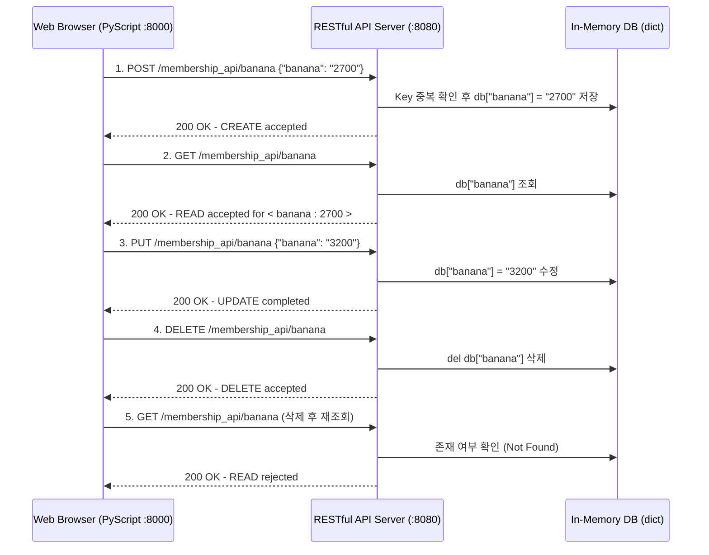
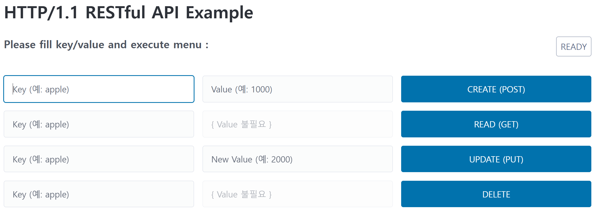
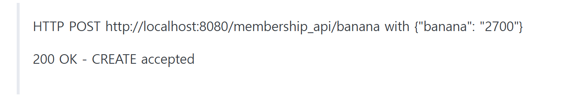
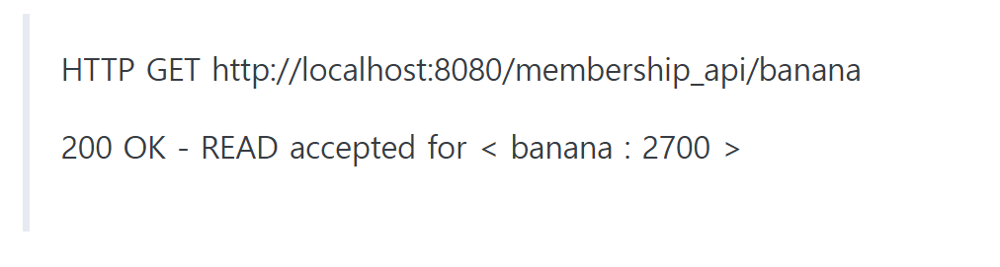
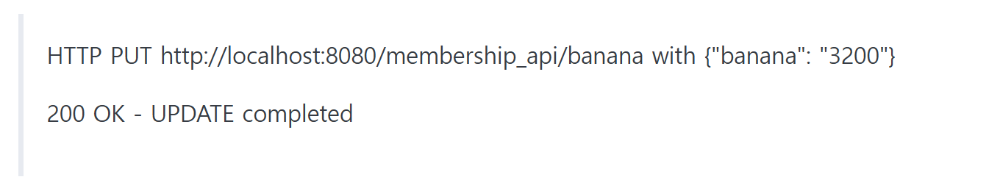
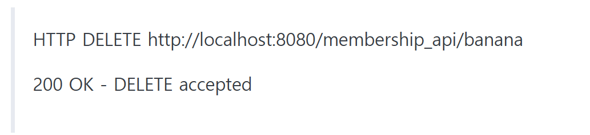
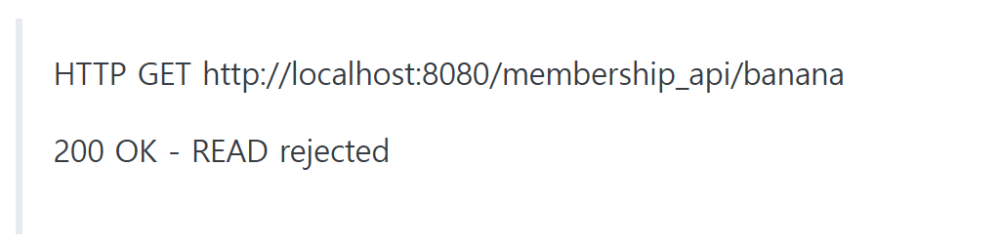
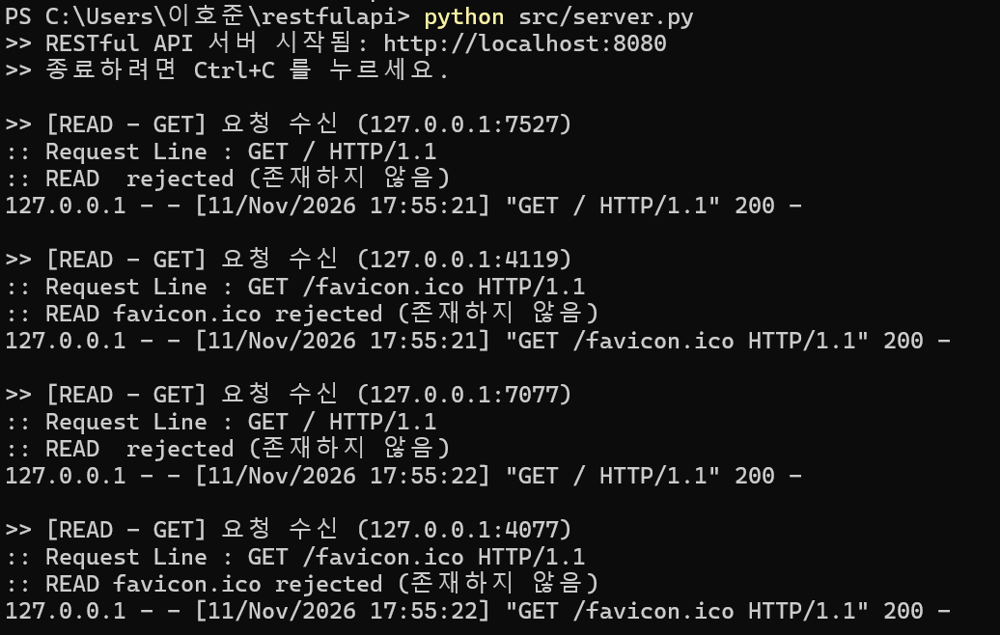
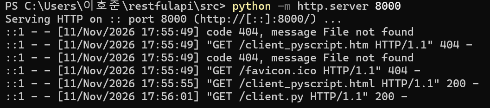

# HTTP/1.1 RESTful API Server and PyScript Client

Python 표준 라이브러리(`http.server`)와 웹 브라우저 기반 Python 실행 환경(`PyScript`)을 활용하여 바닥부터 구현한 **HTTP/1.1 RESTful API(CRUD) 웹 애플리케이션**입니다.

FastAPI나 Flask 같은 고수준 웹 프레임워크의 추상화 계층 뒤에 숨겨진 HTTP 요청 라인 파싱, `Content-Length` 기반 바디 읽기, HTTP Method(`POST`, `GET`, `PUT`, `DELETE`) 분기 라우팅, 그리고 브라우저 CORS Preflight(`OPTIONS`) 처리 과정을 직접 구현하며 HTTP 프로토콜의 동작 원리를 검증했습니다.

---

## Tech Stack

| 구분 | 기술 스택 | 설명 |
| :--- | :--- | :--- |
| **Backend Server** | Python 3.14 (`http.server`) | `BaseHTTPRequestHandler`, `ThreadingHTTPServer` 기반 REST API 서버 (Port: 8080) |
| **Frontend Client** | HTML5, Pico.css, PyScript | 웹 브라우저 내 Python(`client.py`) 실행 및 비동기 이벤트 제어 (Port: 8000) |
| **HTTP Client** | Axios (via PyScript JS FFI) | 비동기(`async/await`) HTTP CRUD 요청 전송 |
| **Protocol / Data** | HTTP/1.1, JSON | Key-Value 데이터 직렬화 및 상태 코드 응답 처리 |
| **Packaging** | Poetry | 프로젝트 환경 및 메타데이터(`pyproject.toml`) 관리 |

---

## System Architecture



### 핵심 구현 내용
1. **HTTP Method 기반 CRUD 라우팅 (`src/server.py`)**
   * `do_POST`: 요청 헤더의 `Content-Length`를 읽어 바이트 스트림(`rfile`)에서 JSON 데이터를 파싱하고, 신규 Key-Value를 등록합니다.
   * `do_GET`: URL 경로(`self.path`)에서 리소스 식별자(Key)를 추출하여 값을 반환합니다.
   * `do_PUT`: 기존 Key의 존재 여부를 검증한 뒤 새로운 Value로 갱신합니다.
   * `do_DELETE`: 요청된 Key를 메모리 저장소(`db`)에서 제거합니다.
2. **브라우저 CORS(Cross-Origin Resource Sharing) 처리**
   * 정적 웹 서버(`localhost:8000`)와 API 서버(`localhost:8080`) 간의 교차 출처 요청을 허용하기 위해 `Access-Control-Allow-Origin`, `Access-Control-Allow-Methods`, `Access-Control-Allow-Headers` 응답 헤더와 `do_OPTIONS` 프리플라이트 핸들러를 직접 구현했습니다.
3. **PyScript 기반 비동기 프론트엔드 연동 (`src/client.py`, `src/client_pyscript.html`)**
   * 별도의 JavaScript 로직 작성 없이 `pyscript.ffi.create_proxy`를 통해 DOM 버튼 이벤트를 Python 비동기 함수(`async def`)에 바인딩하고, 요청 및 응답 결과를 실시간으로 렌더링했습니다.

---

## Execution Screenshots

### 1. 웹 클라이언트 메인 화면


### 2. CRUD 동작 검증 결과 (`banana` 데이터 생명주기 테스트)

#### (1) CREATE (`POST`) - 데이터 생성 (`banana: 2700`)


#### (2) READ (`GET`) - 생성된 데이터 조회


#### (3) UPDATE (`PUT`) - 데이터 값 수정 (`2700` -> `3200`)


#### (4) DELETE (`DELETE`) - 데이터 삭제


#### (5) 삭제 후 재조회 시 예외 처리 확인 (`READ rejected`)


### 3. 서버 실행 로그

| RESTful API Server (`Port: 8080`) | Client Static HTTP Server (`Port: 8000`) |
| :---: | :---: |
|  |  |

---

## Getting Started

### 1. 저장소 클론
```bash
git clone https://github.com/monolail/http1_restfulapi_py.git
cd http1_restfulapi_py
```

### 2. RESTful API 서버 실행 (터미널 1 - Port 8080)
```bash
python src/server.py
```

### 3. 클라이언트 웹 서버 실행 (터미널 2 - Port 8000)
```bash
cd src
python -m http.server 8000
```

### 4. 웹 브라우저 접속 및 테스트
브라우저에서 아래 주소로 접속한 뒤 상단 상태 표시줄이 `READY`로 변경되면 `CREATE`, `READ`, `UPDATE`, `DELETE` 기능을 실행합니다.
* URL: `http://localhost:8000/client_pyscript.html`

---

## Project Structure

```text
http1_restfulapi_py/
├── src/
│   ├── server.py               # ThreadingHTTPServer 기반 RESTful API 서버
│   ├── client.py               # PyScript 기반 브라우저 내 비동기 HTTP 요청 제어 코드
│   └── client_pyscript.html    # Pico.css 및 PyScript가 적용된 클라이언트 웹 UI
├── screen/                     # CRUD 단계별 실행 결과 및 서버 로그 스크린샷
├── pyproject.toml              # Poetry 프로젝트 설정 파일
└── README.md                   # 프로젝트 문서
```
